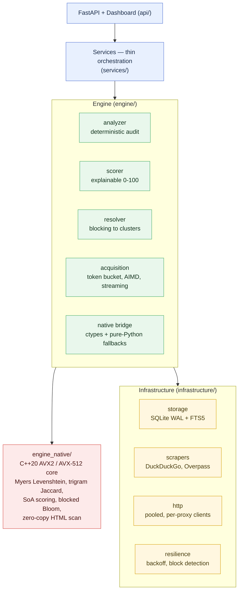
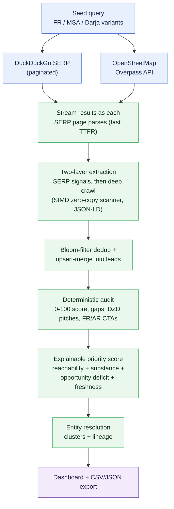
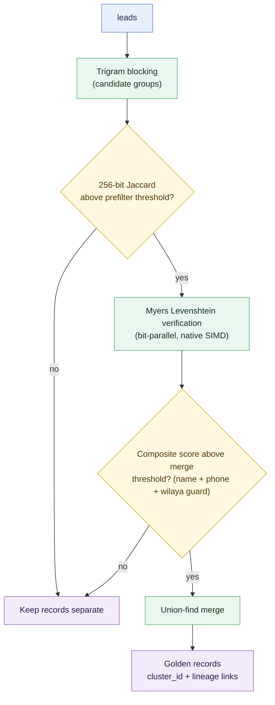
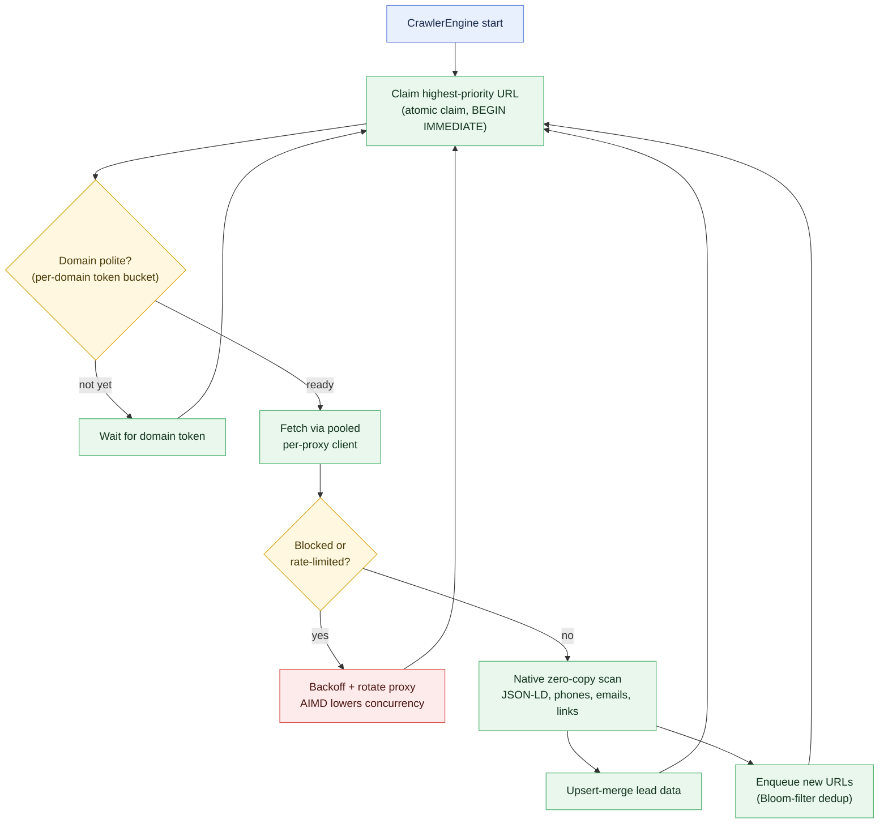

# FreelanceDZ Engine v3.0.1

A deterministic, high-performance **B2B lead-discovery engine for the Algerian
market**, engineered for **personal use on one powerful machine**.

v3 is the synthesis of every previous engineering iteration: it restores the
strongest ideas that were lost along the way (the unified data model from
iteration 1, the deterministic analyzer from iterations 1-3, the C++20 SIMD
native core from iteration 3, streaming web acquisition from iteration 4) and
combines them with the strongest ideas from the v2.0.0 rewrite (two-layer
SERP + schema.org extraction, freshness detection, trigram blocking,
persistent crawl frontier). See **ARCHITECTURE.md** for the full decision
record and measured benchmarks.

## Architecture



## Quick start

```bash
# 1. Install Python dependencies (runtime + test)
pip install -r requirements.txt -r requirements-dev.txt

# 2. Build the native C++20 SIMD core (falls back to pure Python if skipped)
bash engine_native/build.sh

# 3. Run the test suite (107 tests, no network required)
python -m pytest tests/ -q

# 4. Start the engine + dashboard
python main.py                      # serves http://localhost:8080
```

### CLI

```bash
python cli.py discover -q "pharmacie" -w "Alger" -l 30   # streaming campaign
python cli.py analyze                                     # audit + score pending
python cli.py resolve                                     # entity clustering
python cli.py stats                                       # database metrics
python cli.py export -f csv                               # export leads
python cli.py bench                                       # run benchmarks
python cli.py serve --port 8080                           # API + dashboard
```

## What it does

1. **Discover** — expands a query into FR / MSA / Darja variants (offline
   dialect matrix), searches DuckDuckGo (paginated) and OpenStreetMap
   Overpass concurrently, streams results the moment each SERP page is
   parsed (sub-second time-to-first-result).
2. **Extract** — two layers: SERP title/snippet signals, then an optional
   deep crawl of business pages using the native SIMD zero-copy scanner
   (JSON-LD schema.org, phones, emails, socials), with a BeautifulSoup
   fallback for malformed pages.
3. **Audit** — a fully deterministic analyzer (no LLM, no network, no API
   cost) scores digital presence 0-100, lists concrete gaps, and matches
   high-margin freelance service pitches from the Algerian catalog with DZD
   budgets and FR/AR outreach openers.
4. **Score** — explainable 0-100 priority (reachability + substance +
   opportunity deficit + freshness) with a per-factor breakdown.
5. **Resolve** — non-destructive entity clustering: trigram blocking →
   256-bit Jaccard prefilter → Myers Levenshtein verification (native SIMD)
   → composite scoring → union-find → golden records with lineage.
6. **Crawl** — autonomous concurrent crawler with a persistent, resumable
   frontier, per-domain politeness, AIMD adaptive concurrency, proxy
   rotation, block detection, and Bloom-filter URL dedup.



## Entity resolution

Non-destructive by design: clustering never merges or deletes lead rows —
membership lives in `cluster_id` + `entity_links`, so re-running resolution
can always be undone or refined.



## Crawler

The crawler runs N concurrent workers over a persistent SQLite frontier —
crash-safe, resumable, and polite by construction.



## Upgrading from v2.0.0

Existing v2.0.0 databases upgrade automatically on first start. Startup now
reconciles legacy-shaped tables out of the way, applies the v2 baseline
atomically (no more half-applied schema), and migration 8 consolidates the
v1 quartet (`raw_records` + `analyses` + `lead_scores` + `resolved_entities`)
into unified `leads` — preserving CRM status, contact flags, tags, clusters,
attachments, and campaign history. Databases left half-migrated by the v3.0.0
startup crash are detected and completed. Nothing to run manually; back up
`data/leads.db` first if you want a safety net.

## Configuration

All operational parameters live in `config/settings.py` (env-overridable via
`.env`). Hardware-derived defaults (worker counts, concurrency, connection
pools) are computed from `os.cpu_count()` with sanity bounds — nothing is
hardcoded to a specific machine, and nothing is unbounded. Scoring weights
and entity-resolution thresholds are named domain constants in
`engine/scorer.py` / `engine/resolver.py`, not scattered magic numbers.

## Performance

Measured on the development host (2 cores, g++ 14.2, AVX-512 available) —
run `python cli.py bench` to reproduce:

| Path | v2 baseline | v3 native | Speedup |
|---|---|---|---|
| HTML extraction (11 KB page) | 418 pages/s (BS4+lxml) | 44,147 pages/s | **~106x** |
| Batch scoring (100k leads) | 1.15M/s (Python loop) | 3.43M/s | **~3.0x** |
| Entity resolution (4.4k leads) | 11.6k leads/s | 18.0k leads/s | **~1.55x** |
| URL dedup memory (1M URLs) | ~95 MB (Python set) | ~2 MB (blocked Bloom) | **~47x** |

Honest notes: raw per-pair Levenshtein is faster in rapidfuzz than in the
native session, so rapidfuzz remains the *fallback* implementation; the
native core wins where batch amortization and the prefilter cascade apply.
End-to-end throughput is network-bound by design — the CPU-bound stages are
now fast enough that the wire is the limit.

## Project layout

```
engine_native/     C++20 SIMD core (one shared library, plain g++ build)
engine/            Python engine: native bridge, analyzer, scorer, resolver,
                   acquisition (rate limiting, AIMD, streaming)
domain/            Unified Lead model, enums, value objects
infrastructure/    storage (schema v2, repos, legacy reconciliation), scrapers,
                   http, resilience
services/          discovery, crawler, export orchestration
api/               FastAPI routes + dashboard
config/            settings + static catalogs (58 wilayas, dialects, services)
utils/             phone validator, spam filter, freshness, query sanitiser
tests/             107 tests — no network, includes native/fallback parity
                   and the real-v2.0.0-database upgrade path
benchmarks/        reproducible benchmark suite
```
